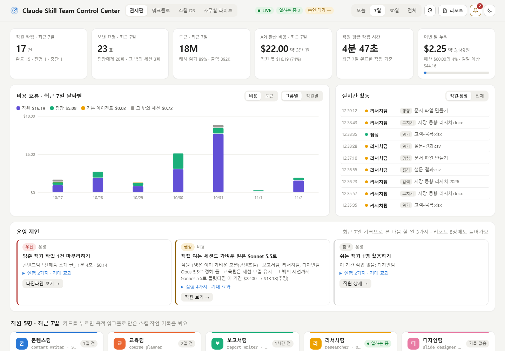
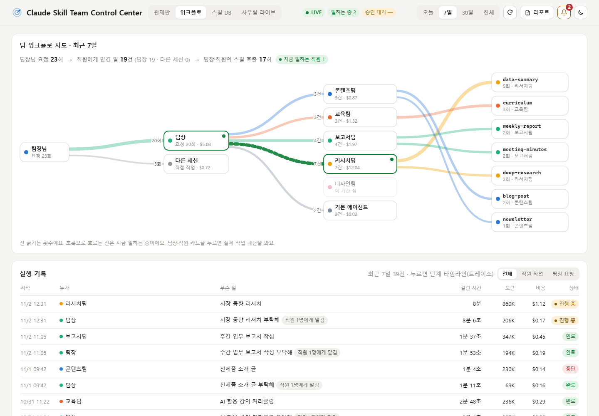
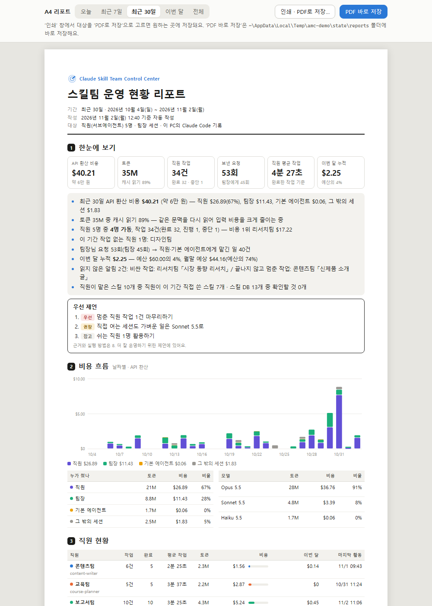

# Claude Skill Team Control Center

[](LICENSE)


[](https://github.com/NogadaHunter/claude-skill-team-control-center/actions/workflows/test.yml)

[한국어](README.md) · **English**

A local control-center dashboard for the **skill team** you have built in Claude Code: your subagent "staff" (`~/.claude/agents/*.md`) and your skills. See what they are doing right now, how much work they have done, and how many tokens and how much API-equivalent cost they have used. Then control it by talking to Claude Code.

> "Show me my skill team status", "Save this month's report as a PDF", "Set the monthly budget to $300"

> [!NOTE]
> The dashboard and the reports are in **Korean**. You can still talk to Claude in English.



<sub>Captured with 5 fictional staff and 4 weeks of fictional history. To try it yourself, see [Try it / development](#try-it--development).</sub>

## What you get

| View | What it shows |
|---|---|
| **Dashboard** | Runs, requests, tokens and API-equivalent cost; daily cost chart; live activity feed (every 2 s); operating advice; staff cards (current task, model, monthly budget); recent runs; top skills |
| **Workflow** | A map of you → lead/other sessions → staff → skills, and a **step timeline (trace)** for every run: time, tokens and cost for each response and tool call |
| **Skill DB** | Calls, last use, owner team and issues for each installed skill (or an optional SkillDB Excel sheet), with an Excel export |
| **Office live** | Cards for the staff working right now. With the optional [3D office](#3d-office-optional): per-session status, "waiting for approval" and a 3D view |
| 🔔 **Alerts & budget** | Monthly budget steps (50/80/100%), month-end forecast, per-staff budgets, expensive runs, stalled runs, spike days, desktop notifications |
| 📄 **A4 report** | Summary, cost, staff, workflow, alerts and an action plan on A4; print it or save it as a PDF in one click |
| 💡 **Operating advice** | "So what should I do?" from your own history, with evidence, steps and expected effect |

| Workflow & step timeline | A4 report |
|---|---|
|  |  |

## Requirements

- **Claude Code** on Windows, macOS or Linux. It reads this computer's Claude Code transcripts, so claude.ai (web/app) is not supported.
- **Node.js 18 or later**. Check with `node -v`; install the LTS from https://nodejs.org if needed. If you installed Claude Code with the native installer, you may not have Node.js yet.
- Optional: Chrome or Edge, for the standalone window and one-click PDF. Without them it opens your default browser, and you save PDFs from the print dialog.
- Optional: staff (subagent) `.md` files in `~/.claude/agents/`. Sessions and skill usage show up without them.

## Install

### A. Claude Code plugin (recommended)

Inside Claude Code:

```text
/plugin marketplace add NogadaHunter/claude-skill-team-control-center
/plugin install skill-team-control-center@peopleware-skill-team
```

From a terminal:

```bash
claude plugin marketplace add NogadaHunter/claude-skill-team-control-center
claude plugin install skill-team-control-center@peopleware-skill-team
```

Then **start a new Claude Code session** and say:

> Set up the skill team control center and open it

Claude checks Node.js, asks what the dashboard should call you, drafts the settings from your staff files and opens the dashboard. The first scan reads all transcripts (about 20 seconds per GB).

### B. Copy into your skills folder

Download [`dist/skill-team-control-center.skill`](dist/skill-team-control-center.skill) (a zip), extract it, and put the `skill-team-control-center` folder in `~/.claude/skills/` (Windows: `C:\Users\<you>\.claude\skills\`).

## Usage

| Say | What happens |
|---|---|
| Show me my skill team status | Cost, staff, monthly budget, live state, alerts and top advice |
| Open the dashboard | Opens http://127.0.0.1:4790 |
| What are my staff doing? | Per-staff status |
| Give me operating advice | All advice with evidence, steps and expected effect |
| Set the monthly budget to $300 | Saves budget and alert thresholds |
| Save this month's report as a PDF | Saves an A4 PDF and tells you where |
| Export skill usage to Excel | Saves an .xlsx file |
| Switch the report staff to Sonnet | Edits `model` in that staff `.md` (after confirming; applies from the next session) |
| Stop the dashboard | Stops the local server |

From a terminal: `node <skill folder>/app/scripts/ctl.mjs help`

## 3D office (optional)

The 3D view and the "waiting for approval" detection in the Office live tab come from [claude-3d-frog-office](https://github.com/d-onworks/claude-3d-frog-office), a free open-source project (MIT) by another developer. It is **not bundled** with this plugin.

| Feature | This plugin only | With the 3D office |
|---|---|---|
| Cards for staff working now | ✓ (from transcripts) | ✓ |
| "Waiting for approval" detection | – | ✓ |
| Per-project (session) cards | lead and staff only | ✓ |
| 3D view | – | ✓ (new window) |

- The 3D office adds hooks to your Claude Code `settings.json` when you install it. Read its README before you decide.
- When it is installed, the dashboard finds it automatically (default port 4777). When it is not, the Office live tab shows an install link instead of "3D로 보기".

## Data and privacy

- It **only reads** this computer's Claude Code transcripts (`~/.claude/projects`) and staff files (`~/.claude/agents`). It changes one `model` line in a staff file only when you ask it to.
- The server listens on `127.0.0.1` only and **sends nothing out**. Requests from other sites are rejected.
- Raw shell commands are never shown, because they can contain secrets.

## Good to know

- **Costs are API-equivalent estimates**, priced with the public Claude API rates ("what this would have cost on the API"). They are not your Pro/Max subscription bill. Rates live in `app/config/pricing.json` (as of 2026-10); KRW assumes 1,400 per USD.
- **It reads Claude Code's internal transcript format**, which is not a documented API. A Claude Code update may skew some numbers; please [open an issue](https://github.com/NogadaHunter/claude-skill-team-control-center/issues) if something looks off.
- Port 4790 busy? Start it with `PORT=4791`.
- The SkillDB Excel sheet is optional. Without it, installed skills (`~/.claude/skills` and plugin skills) are read automatically.

## Where settings live

`~/.agent-mission-control/` (kept across plugin updates): `config/profiles.json` (your name, staff teams, colors, goals, lead project), `config/budget.json`, `config/skilldb.json` (optional), `reports/`, plus `cache.json`, `alerts.json` and `server.log`.

## Update / uninstall

- **Update**: `claude plugin marketplace update peopleware-skill-team` → `claude plugin update skill-team-control-center@peopleware-skill-team`. The next start replaces the old server with the new version.
- **Uninstall**: stop the server ("Stop the dashboard") → `claude plugin uninstall skill-team-control-center@peopleware-skill-team` → delete `~/.agent-mission-control`.

## Try it / development

```bash
git clone https://github.com/NogadaHunter/claude-skill-team-control-center.git
cd claude-skill-team-control-center
npm run demo     # fictional data on http://127.0.0.1:4795 (your real history is never touched)
npm test         # tests
npm run check    # repository checks
```

No dependencies: the app uses only Node.js built-ins. Changes: [`CHANGELOG.md`](CHANGELOG.md)

## License

[MIT](LICENSE). The 3D office (claude-3d-frog-office) is a separate project under its own license.

## Made by

Peopleware Education Consulting Group · AI Prompt Lab
