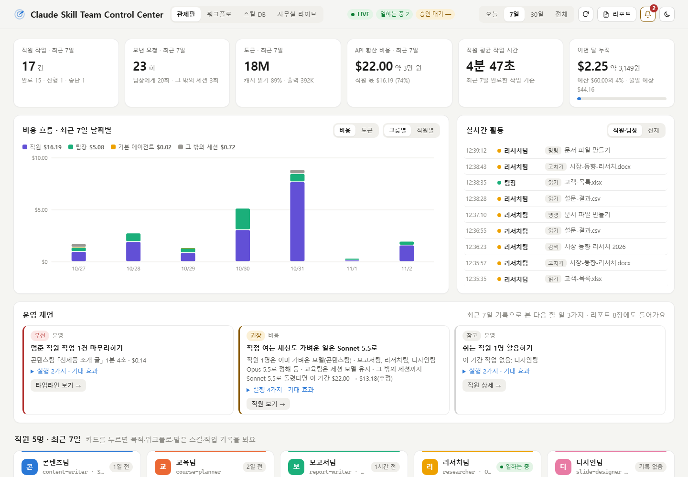
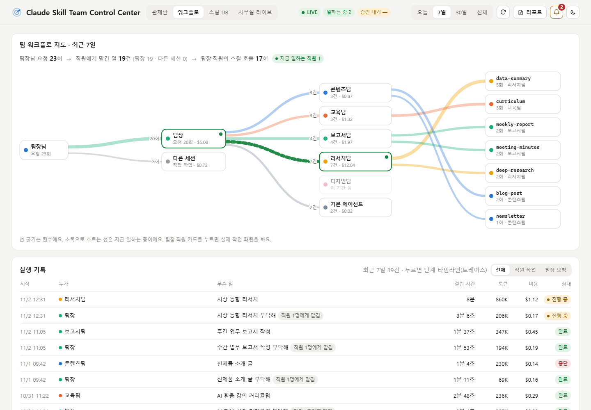
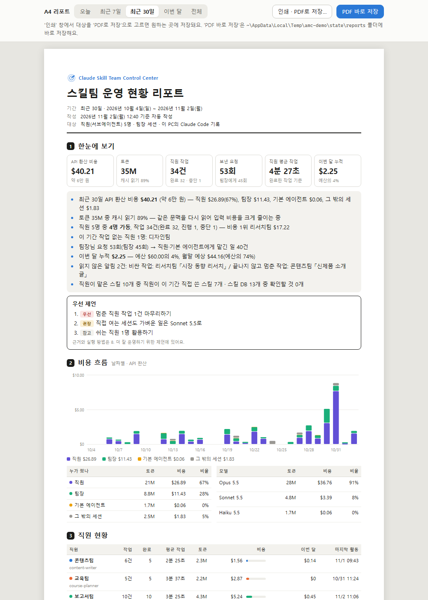
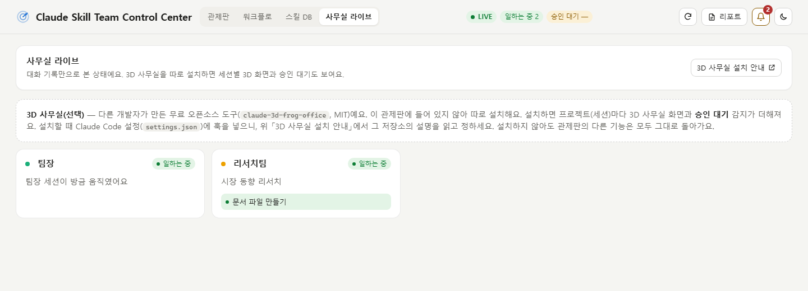

# Claude Skill Team Control Center

[](LICENSE)


[](https://github.com/NogadaHunter/claude-skill-team-control-center/actions/workflows/test.yml)

Claude Code에 만들어 둔 **스킬팀(서브에이전트 직원과 스킬)**이 지금 무엇을 하는지, 그동안 얼마나 일했는지, 토큰과 비용을 얼마나 썼는지를 **한 화면에서 보고 말로 조작하는** 로컬 관제 대시보드예요.

> "스킬팀 현황 알려줘", "이번 달 리포트 PDF로 저장해줘", "월 예산 300달러로 정해줘"처럼 Claude Code에게 말하면 돼요.



<sub>가상 직원 5명과 4주치 가상 기록으로 찍은 화면이에요. 직접 띄워 보려면 아래 [직접 띄워 보기](#직접-띄워-보기--개발)를 보세요.</sub>

## 무엇을 볼 수 있나요

| 화면 | 보여 주는 것 |
|---|---|
| **관제판** | 작업 건수·요청·토큰·API 환산 비용, 날짜별 비용 흐름, 실시간 활동(2초마다), 운영 제언, 직원 카드(지금 하는 일·모델·이번 달 예산), 최근 작업, 스킬 사용 순위 |
| **워크플로** | 사용자 → 팀장·다른 세션 → 직원 → 스킬로 흐르는 지도, 실행마다 **단계 타임라인**(응답·도구별 걸린 시간·토큰·비용) |
| **스킬 DB** | 설치된 스킬(또는 스킬 DB 엑셀)별 호출 수·마지막 사용·담당 팀·확인할 점, 사용 현황 엑셀 내보내기 |
| **사무실 라이브** | 지금 일하는 직원 카드. [3D 사무실](#3d-사무실선택)을 따로 설치하면 세션별 상태·승인 대기·3D 화면까지 |
| 🔔 **알림·예산** | 월 예산 단계(50·80·100%), 월말 초과 예상, 직원별 예산, 비싼 작업, 멈춘 작업, 갑자기 많이 쓴 날, 바탕화면 알림 |
| 📄 **A4 리포트** | 개조식 요약·비용·직원·워크플로·알림·실행 계획을 A4로. 인쇄하거나 PDF로 바로 저장 |
| 💡 **운영 제언** | 기록을 보고 "그래서 무엇을 하면 좋은가": 근거 숫자, 실행 방법, 기대 효과 |

| 워크플로 · 단계 타임라인 | A4 리포트 |
|---|---|
|  |  |

## 준비물

- **Claude Code** (Windows · macOS · Linux). 이 PC의 대화 기록을 읽기 때문에 claude.ai 웹·앱에서는 쓸 수 없어요.
- **Node.js 18 이상**. 터미널에서 `node -v`로 확인하고, 없으면 https://nodejs.org 에서 LTS를 설치하세요.
  Claude Code를 네이티브 설치기로 깔았다면 Node.js가 없을 수 있어요.
- (선택) Chrome 또는 Edge. 독립 창으로 열기와 'PDF 바로 저장'에 써요. 없으면 기본 브라우저로 열고, PDF는 인쇄 창에서 저장해요.
- (선택) `~/.claude/agents/`의 직원(서브에이전트) `.md`. 없어도 세션과 스킬 사용은 보여요.

## 설치

### A. Claude Code 플러그인 (추천)

Claude Code 안에서:

```text
/plugin marketplace add NogadaHunter/claude-skill-team-control-center
/plugin install skill-team-control-center@peopleware-skill-team
```

터미널에서:

```bash
claude plugin marketplace add NogadaHunter/claude-skill-team-control-center
claude plugin install skill-team-control-center@peopleware-skill-team
```

설치한 뒤 Claude Code를 **새로 시작**하고 이렇게 말하세요.

> 스킬팀 관제판 설치하고 열어줘

Claude가 Node.js를 확인하고, 화면에서 부를 이름(예: 대표님, 팀장님)을 물은 뒤, 직원 목록으로 설정 초안을 만들고 관제판 창을 열어 줘요.
처음에는 대화 기록을 모두 읽느라 시간이 걸려요(1GB에 20초쯤).

### B. 스킬 폴더에 직접 넣기

[`dist/skill-team-control-center.skill`](dist/skill-team-control-center.skill)(zip 파일)을 받아 풀고, `skill-team-control-center` 폴더를 통째로 아래에 넣어요.

- Windows: `C:\Users\<나>\.claude\skills\skill-team-control-center\`
- macOS·Linux: `~/.claude/skills/skill-team-control-center/`

## 쓰는 법

| 이렇게 말하면 | 하는 일 |
|---|---|
| 스킬팀 현황 알려줘 | 비용·직원·이번 달 예산·지금 상태·알림·우선 제언 요약 |
| 관제판 열어줘 | 대시보드 창 열기(http://127.0.0.1:4790) |
| 직원들 뭐 하고 있어? | 직원별 현황 |
| 운영 제언 알려줘 | 더 잘 운영하기 위한 제언 전부(근거·실행·기대 효과) |
| 월 예산 300달러로 정해줘 | 예산·알림 기준 저장 |
| 이번 달 리포트 PDF로 저장해줘 | A4 리포트 PDF를 저장하고 경로 안내 |
| 스킬 사용 현황 엑셀로 줘 | 엑셀 파일 저장 |
| 보고서팀 직원을 Sonnet으로 바꿔줘 | 직원 `.md`의 `model` 바꾸기(한 번 확인한 뒤, 새 세션부터 적용) |
| 관제판 꺼줘 | 서버 끄기 |

터미널에서 직접 써도 돼요: `node <스킬 폴더>/app/scripts/ctl.mjs help`

## 3D 사무실(선택)

'사무실 라이브' 탭의 3D 화면과 **승인 대기** 감지는 다른 개발자가 만든 무료 오픈소스 [claude-3d-frog-office](https://github.com/d-onworks/claude-3d-frog-office)(MIT)가 있어야 보여요. 이 플러그인에는 들어 있지 않아요.

| 기능 | 이 플러그인만 | 3D 사무실도 설치 |
|---|---|---|
| 지금 일하는 직원 카드 | ○ (대화 기록으로) | ○ |
| 승인 대기 감지, 머리말 '승인 대기 n' | – | ○ |
| 프로젝트(세션)별 카드 | 팀장·직원 위주 | ○ |
| 3D로 보기 | – | ○ (새 창) |

- 3D 사무실은 설치할 때 Claude Code 설정(`settings.json`)에 훅을 넣어요. 그 저장소의 README를 읽고 정하세요.
- 설치되어 있으면 관제판이 저절로 찾아 연결해요(기본 포트 4777). 없으면 '사무실 라이브' 탭에 「3D 사무실 설치 안내」 단추가 보여요.
- 3D 화면은 그쪽 서버가 다른 페이지 안에 넣는 것을 막아 두어서 새 창으로 열려요.



## 데이터와 개인정보

- 이 PC의 Claude Code 기록(`~/.claude/projects`)과 직원 파일(`~/.claude/agents`)을 **읽기만** 해요. 직원 모델 바꾸기를 요청했을 때만 그 파일의 `model` 한 줄을 고쳐요.
- 서버는 이 컴퓨터(`127.0.0.1`)에서만 열리고 **외부로 아무것도 보내지 않아요.** 다른 사이트에서 오는 요청은 막아요.
- 명령(Bash·PowerShell) 원문은 비밀값이 섞일 수 있어 화면에 보여 주지 않아요.

## 알아 둘 점

- **비용은 환산값이에요.** Claude API 공식 단가로 'API로 썼다면 얼마였을지'를 계산한 값이라, 구독 요금제(Pro·Max)의 실제 청구액이 아니에요. 단가표는 `app/config/pricing.json`(2026-10 기준)이고, 원화는 환율 1,400원을 가정해요.
- **Claude Code의 내부 기록 형식을 읽어요.** 공식 문서에 없는 형식이라, Claude Code가 업데이트되면 일부 수치가 어긋날 수 있어요. 이상하면 [이슈](https://github.com/NogadaHunter/claude-skill-team-control-center/issues)로 알려 주세요.
- 화면은 **한국어**예요.
- claude.ai 웹·앱에서 한 일은 이 PC 기록에 없어서 빠져요.
- 포트 4790을 다른 프로그램이 쓰고 있으면 `PORT=4791`처럼 다른 포트로 켜요.
- 스킬 DB 엑셀(SkillDB 표)은 선택이에요. 없으면 설치된 스킬(`~/.claude/skills`, 플러그인 스킬)을 자동으로 읽어요.

## 설정·데이터가 있는 곳

`~/.agent-mission-control/` 폴더예요. 플러그인을 새 판으로 바꿔도 남아요.

| 파일 | 내용 |
|---|---|
| `config/profiles.json` | 부르는 이름(owner), 직원 팀 이름·색·목적·목표·워크플로, 팀장 세션 폴더. 자유롭게 고쳐요 |
| `config/budget.json` | 월 예산·알림 기준(화면의 🔔에서 고쳐요) |
| `config/skilldb.json` | (선택) 스킬 DB 엑셀 위치 |
| `reports/` | 'PDF 바로 저장'한 리포트, 내보낸 엑셀 |
| `cache.json` · `alerts.json` · `server.log` | 집계 캐시, 알림 읽음 기록, 서버 로그 |

## 업데이트 · 지우기

- **업데이트**: `claude plugin marketplace update peopleware-skill-team` → `claude plugin update skill-team-control-center@peopleware-skill-team`. 다음에 관제판을 켜면 예전 판 서버를 끄고 새 판으로 다시 켜요.
- **지우기**: "관제판 꺼줘"로 서버를 끄고 → `claude plugin uninstall skill-team-control-center@peopleware-skill-team` → `~/.agent-mission-control` 폴더를 지워요.

## 직접 띄워 보기 · 개발

```bash
git clone https://github.com/NogadaHunter/claude-skill-team-control-center.git
cd claude-skill-team-control-center
npm run demo     # 가상 데이터로 http://127.0.0.1:4795 에 띄워요(진짜 기록은 건드리지 않아요)
npm test         # 시험
npm run check    # 저장소 구조 점검
```

```text
claude-skill-team-control-center/
├── .claude-plugin/marketplace.json            ← Claude Code 마켓플레이스 목록
├── plugins/skill-team-control-center/
│   ├── .claude-plugin/plugin.json             ← 플러그인 정보(이름·판)
│   └── skills/skill-team-control-center/      ← 스킬 본체
│       ├── SKILL.md                           ← Claude가 읽는 설명서(요청 → 명령)
│       └── app/                               ← 서버·화면·단가표·ctl.mjs(의존성 없음)
├── dist/skill-team-control-center.skill       ← 직접 설치용 zip
├── docs/                                      ← 화면 사진, 올리는 법
├── test/                                      ← 시험(가짜 기록으로 돌아요)
└── tools/                                     ← demo · screenshots · run-tests · check-repo
```

변경 내역: [`CHANGELOG.md`](CHANGELOG.md)

## 라이선스

[MIT](LICENSE). 자유롭게 쓰고, 고치고, 다시 배포할 수 있어요(저작권 표시는 남겨 주세요).
3D 사무실(claude-3d-frog-office)은 별도 프로젝트이며 그 저장소의 라이선스를 따라요.

## 만든 곳

피플웨어교육컨설팅그룹 · AI프롬프트연구소

---

### English summary

A local dashboard and Claude Code plugin that shows what your **Claude Code skill team** (subagent staff and skills) is doing right now, how much work it has done, and how many tokens and how much API-equivalent cost it has used. It also lets you control it by asking Claude: status, budgets and alerts, A4 PDF reports, skill usage exports, staff model changes and data-driven operating advice. It reads local Claude Code transcripts only and sends nothing out. Requires Node.js 18+. The interface is Korean. See [README.en.md](README.en.md).
